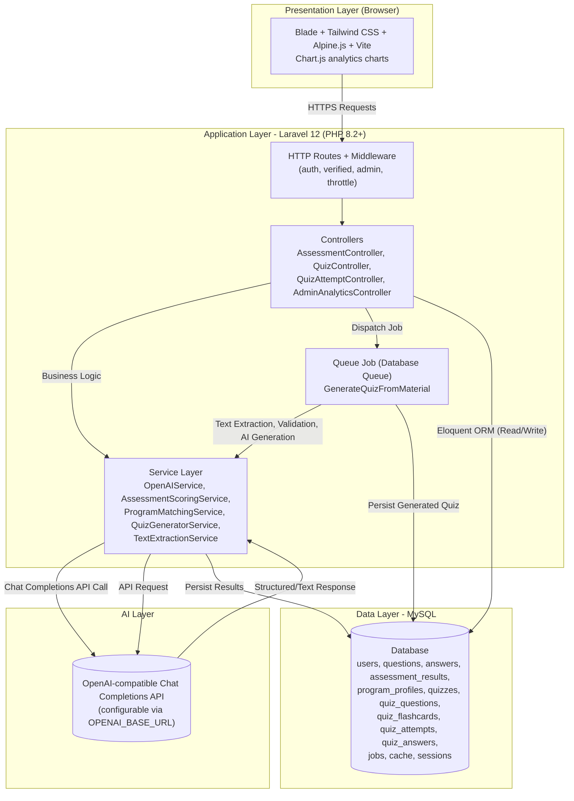

# System Architecture

**Layers:** Client (Browser) → Laravel application → OpenAI-compatible API and MySQL. Quiz generation runs asynchronously through Laravel's database-backed queue worker. Assessment scoring and program matching are deterministic; the AI service is used only to generate a cautious explanatory narrative of the computed profile, with a score-based fallback if the AI call fails.
