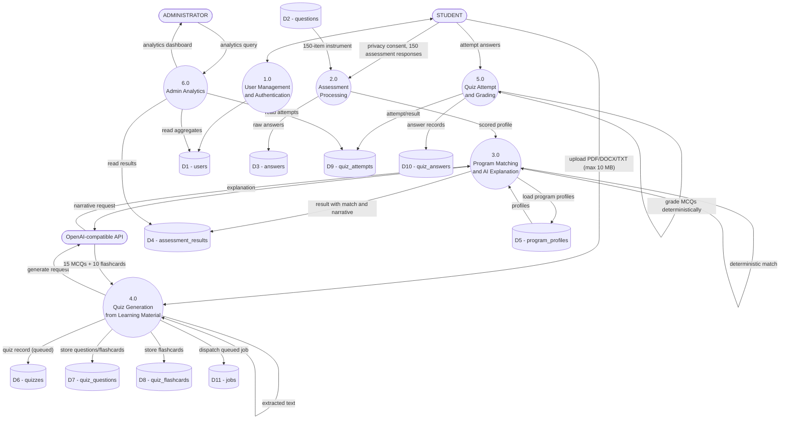

# Data Flow Diagram - Level 1

**Notes:** Program matching is deterministic using configured program profiles. AI is only used for generating a cautious explanatory narrative of the computed profile, with score-based fallback if the call fails. Quiz generation is asynchronous via Laravel database-backed queue and produces exactly 15 MCQs and 10 flashcards. MCQs are graded deterministically.
