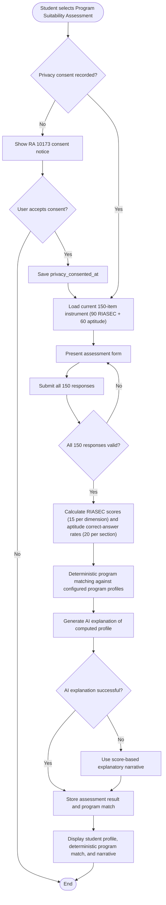

# Assessment Module Flowchart

**Notes:** Assessment requires exactly 150 responses. Program matching is deterministic; AI is only used to explain the computed profile with a fallback to a score-based summary if the AI call fails.
