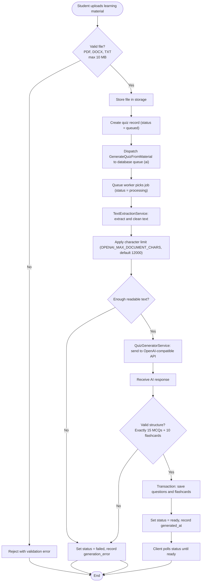

# AI Quiz Generation Flowchart

**Notes:** Quiz generation is asynchronous via Laravel database-backed queue. The AI generates exactly 15 MCQs and 10 flashcards; the structure is validated. Text is capped by OPENAI_MAX_DOCUMENT_CHARS (default ~12000). The system does not guarantee topic-by-topic coverage of the entire document. MCQs are graded deterministically.
