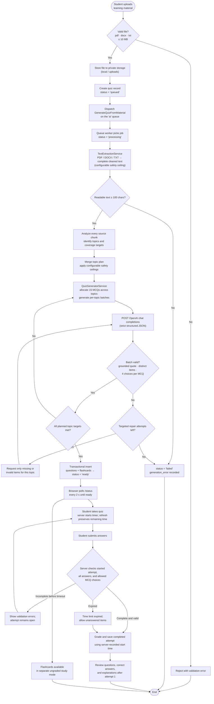

# AI Quiz Generator Flowchart

- The upload endpoint responds immediately; generation runs asynchronously on the queue
  worker so the UI is not blocked.
- Every document chunk is analyzed, then topic-specific batches are generated and validated.
  Missing coverage triggers targeted fill-in batches;   MCQs total 15 by default; flashcard counts remain content-driven. Configurable maxima
  are technical safety ceilings.
- Students must complete an attempt before generated questions, answer keys, and explanations are
  available for review.
- The server enforces the attempt start time, duration, answer completeness before timeout, and
  that MCQ responses match the generated choices. After the server-measured time expires, unanswered
  items may be submitted and are scored as unanswered.
- Answer keys and explanations are revealed after the first completed attempt.