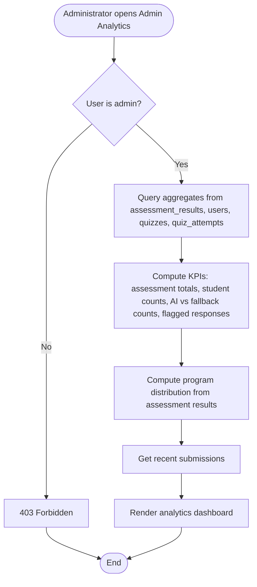

# Admin Analytics Flowchart

**Notes:** Analytics are generated from stored data. Metrics include assessment totals, student counts, program distribution, AI-generated vs fallback counts, flagged-response counts, and recent submissions.
