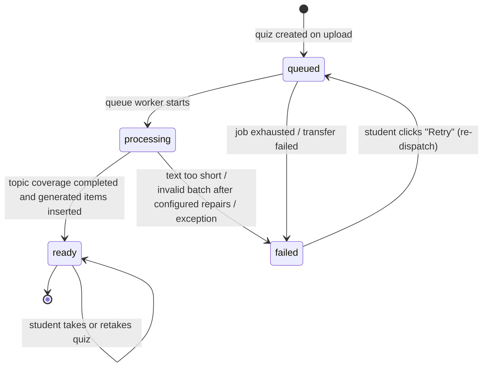

# Quiz Status State Diagram

- `queued` → `processing` → `ready` is the happy path; generation is fully asynchronous.
- A `failed` quiz retains the stored error message and can be retried, re-dispatching the
  job without re-uploading the file.