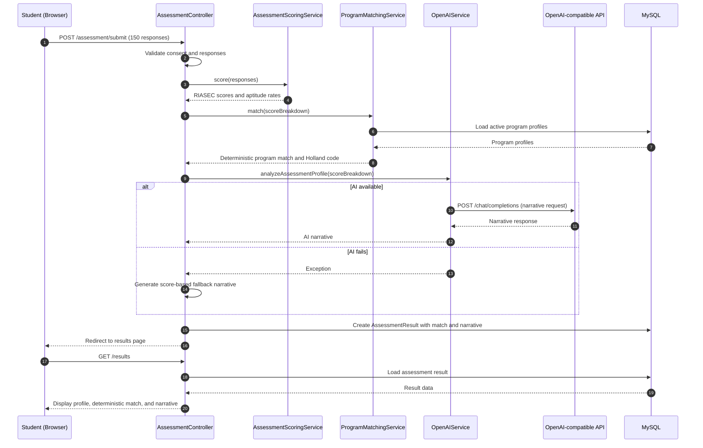

# Sequence Diagram - Assessment Submission

**Notes:** Program matching is deterministic and happens before AI explanation. AI only generates a cautious narrative/explanation; if it fails, a score-based fallback is used.
