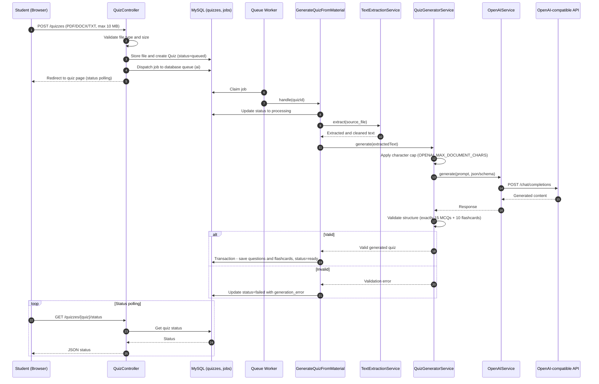

# Sequence Diagram - Quiz Generation

**Notes:** Generation is asynchronous via Laravel database-backed queue. Exactly 15 MCQs and 10 flashcards are generated and validated. Text is capped by configuration.
