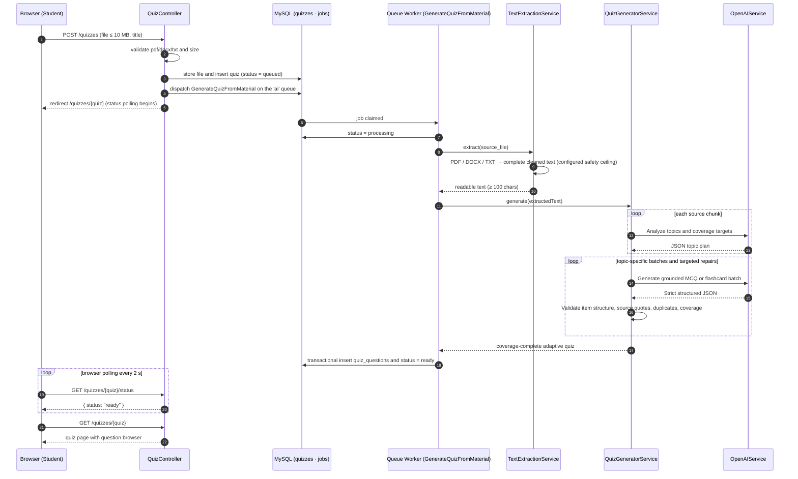

# Sequence Diagram — AI Quiz Generation

**Key behaviors:** the upload endpoint returns immediately and all heavy work runs on the
queue worker; every source chunk is analyzed, then 15 MCQs are distributed across topics,
validated in batches, and missing items are requested without regenerating valid items.
Flashcard count remains based on document coverage.