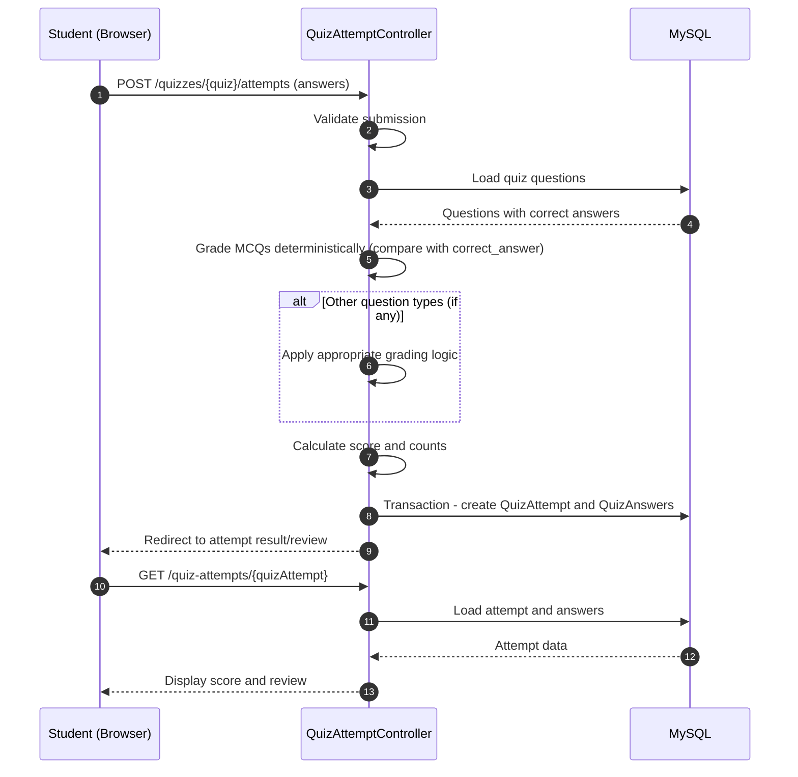

# Sequence Diagram - Answer Grading

**Notes:** MCQs are graded deterministically by comparing student answers with stored correct answers. The system retains compatibility for older identification questions, but the current quiz generator produces only MCQs and flashcards.
